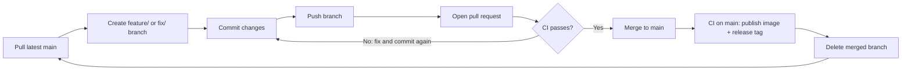
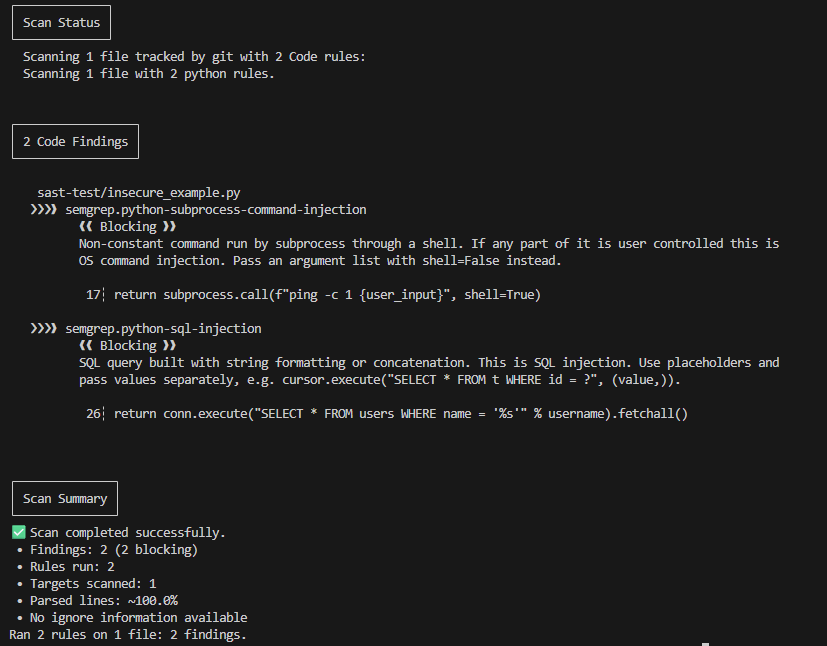
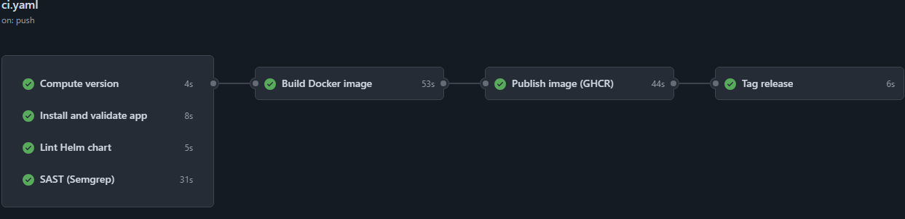
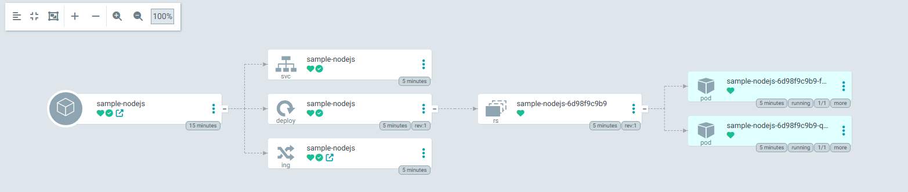
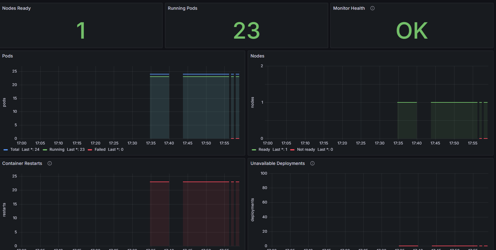
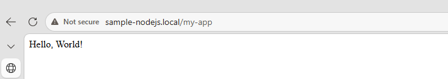

# Implementation Summary

This document summarizes how the DevOps/DevSecOps home assignment was implemented, stage by stage.
Each stage was delivered on its own branch and merged to `main` only after CI passed.
Screenshots show actual results from the pipeline, the cluster and the monitoring stack.

## Development Workflow

## Stage 1: Dockerize the Application

Added a `Dockerfile` and `.dockerignore`, and fixed the `package.json` entry point and start script (PR #1).
The image was hardened in Stage 5. It is validated on every CI run, where it is built and smoke-tested as a container.

## Stage 2: Helm Chart and Ingress

Created the `helm/sample-nodejs` chart: a Deployment with 2 replicas, readiness and liveness probes, CPU/memory requests and limits,
a non-root security context, a ClusterIP Service and an optional Ingress (PR #2). A Deployment was chosen because the app is stateless.
Traefik Ingress was then enabled for local deployment (PR #3). The chart is validated in CI by `helm lint` and `helm template` with each values file.

## Stage 3: CI Pipeline and Versioning

Added a GitHub Actions workflow (`.github/workflows/ci.yaml`) that runs on every pull request and push to `main` (PR #4).
`scripts/next_version.py` computes the next SemVer version from Conventional Commit messages, and a `vX.Y.Z` tag is created on `main` after all jobs pass.
Validated by successful CI runs and the release tags `v1.0.0` to `v1.7.0`.

## Stage 4: SAST with Semgrep

Added a Semgrep job with the `p/javascript`, `p/python` and `p/owasp-top-ten` rulesets and custom CRITICAL rules in `.semgrep/critical.yml` (PR #5).
`scripts/sast_gate.py` blocks the pipeline on CRITICAL findings from the configured Semgrep rules or scan errors. The custom blocking rules cover Python command injection and SQL injection.

The screenshot is a **local security demonstration**, not a GitHub Actions result: the custom rules were run against an intentionally insecure test file
that is kept out of the repository. Both vulnerabilities (OS command injection and SQL injection) are detected as blocking.

## Stage 5: Image Scanning with Trivy

Added a Trivy scan of the built image (PR #6). Any HIGH or CRITICAL vulnerability fails the build job, so the image is never published or deployed.
The runtime image was hardened at the same time: a multi-stage build on a distroless Node.js 22 base running as a non-root user.
Validated by the `Build Docker image` CI job.

## Stage 6: Publish to Private GHCR

Added a `main`-only publish job that pushes the exact image that was scanned to the private registry `ghcr.io/mulufan/sample-nodejs` (PR #7).
`scripts/ghcr_publish.py` verifies the image ID, pushes the `X.Y.Z` and `sha-<commit>` tags, and never overwrites an existing version.
The screenshot shows a full run on `main`: all checks passed, then the image was published and the release tagged.

## Stage 7: GitOps Deployment with Argo CD

Added an Argo CD Application (`argocd/application.yaml`) that deploys the Helm chart from this repository with `values-gitops.yaml` (PR #8).
Argo CD pulls the manifests directly from the app repository, which keeps the setup simple for a single application.
Automated sync and self-heal are enabled. Validated in the Argo CD UI with all resources Synced and Healthy.

## Stage 8: Automated Image Deployment

New releases are deployed automatically by Argo CD Image Updater (`argocd/image-updater.yaml`, PR #11). It selects the highest `X.Y.Z` tag in GHCR and sets it on the Argo CD Application.
A CI job that committed the new tag to Git was tried first (PR #9) and removed because the `main` ruleset blocks direct pushes (PR #10).
Validated in the cluster: the Application is Synced and Healthy and runs the latest release, `1.7.0`.

## Stage 9: Kubernetes Monitoring (Bonus)

Added a Python monitor (`monitoring/k8s_monitor.py`) that reads node, pod and deployment status from the Kubernetes API and exports Prometheus metrics (PR #12).
Prometheus and Grafana run locally with Docker Compose, with the datasource and dashboard provisioned from files.
Validated with the Grafana dashboard showing node readiness, pod counts, restarts and monitor health.

## Stage 10: Final Validation and Documentation

The final README documents quick-start commands and the architecture.
The application was validated end to end through the Traefik Ingress: `http://sample-nodejs.local/my-app` returns HTTP 200 with `Hello, World!`.

## Completion Summary

| Requirement | Implementation |
|---|---|
| Helm chart | Deployment, probes, resources, security context, Service, Ingress |
| Version bumping | SemVer from Conventional Commits, release tags on `main` |
| SAST | Semgrep, pipeline fails on CRITICAL findings |
| Image scanning | Trivy, HIGH/CRITICAL findings block publish and deployment |
| Build and private registry | Docker Buildx, private GHCR |
| GitOps deployment | Argo CD and Argo CD Image Updater |
| Bonus | Python Kubernetes monitor with Prometheus and Grafana |

Known limitations: the Semgrep gate's CRITICAL rules currently cover two Python vulnerability classes only, and Image Updater sets the deployed tag
on the Argo CD Application instead of committing it to Git.
