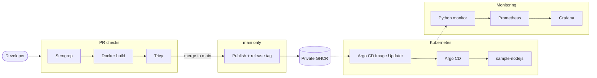

# DevOps Sample Node.js App

> Stage-by-stage implementation notes and screenshots: [IMPLEMENTATION.md](IMPLEMENTATION.md)

## Project Overview

A small Express app (`app.js`) with Prometheus metrics, packaged as a non-root distroless Docker image and deployed to Kubernetes with a Helm chart.
GitHub Actions validates, scans (Semgrep, Trivy), versions and publishes the image to a private GHCR registry.
Argo CD and Argo CD Image Updater deploy each new release to the cluster (GitOps, pull-based).
A separate Python monitor exports cluster metrics to a local Prometheus and Grafana stack.

## Quick Start

**Prerequisites:** Docker, Helm, Python 3, kubectl. Commands are for a bash shell from the repository root.

**Docker build and run** (host port 8081; the image listens on 8080)

```sh
docker build -t sample-nodejs:local .
docker run -d --name sample-nodejs -p 8081:8080 sample-nodejs:local
python3 scripts/smoke_test.py http://localhost:8081   # checks /ready, /live, /my-app, /metrics
docker rm -f sample-nodejs
```

**Helm lint and template** (as in CI, using the GitOps values)

```sh
helm lint helm/sample-nodejs -f helm/sample-nodejs/values-gitops.yaml
helm template sample-nodejs helm/sample-nodejs -f helm/sample-nodejs/values-gitops.yaml
```

**Semgrep security scan** (same scan and gate as CI)

```sh
docker run --rm -v "$PWD:/src" -w /src semgrep/semgrep:1.180.0 \
  semgrep scan --config p/javascript --config p/python --config p/owasp-top-ten \
  --config .semgrep/critical.yml --exclude helm/sample-nodejs/templates \
  --metrics=off --json-output=semgrep.json
python3 scripts/sast_gate.py semgrep.json
```

The gate fails only on CRITICAL findings, defined by the custom Python rules in `.semgrep/critical.yml`
(subprocess with `shell=True`, SQL built from formatted strings). All other findings are reported only.
To see it fail, add a Python file with e.g. `subprocess.run(cmd, shell=True)` and re-run.
In Git Bash on Windows, prefix the `docker run` with `MSYS_NO_PATHCONV=1`.

**Kubernetes and Argo CD**

Cluster prerequisites (installed manually, not part of this repo): Traefik ingress controller, Argo CD,
Argo CD Image Updater, the `sample-nodejs` namespace, a `ghcr-pull-secret` docker-registry secret in both
the `sample-nodejs` and `argocd` namespaces, and a hosts entry `127.0.0.1 sample-nodejs.local`.

```sh
kubectl apply -f argocd/application.yaml
kubectl apply -f argocd/image-updater.yaml

kubectl -n argocd get applications.argoproj.io sample-nodejs   # SYNC / HEALTH status
kubectl -n argocd get imageupdaters
kubectl -n sample-nodejs get deploy,pods,svc,ingress
curl http://sample-nodejs.local/my-app                          # Hello, World!
```

**Monitoring** (Windows host, kubeconfig context `docker-desktop`)

```sh
python -m venv monitoring/.venv
monitoring/.venv/Scripts/python -m pip install -r monitoring/requirements.txt
monitoring/.venv/Scripts/python monitoring/k8s_monitor.py      # metrics on 127.0.0.1:8002, Ctrl+C to stop

docker compose -f monitoring/docker-compose.yml up -d          # Prometheus :9090, Grafana :3000
docker compose -f monitoring/docker-compose.yml down           # keeps the data volumes
```

Grafana opens the provisioned "Kubernetes Monitor" dashboard at http://localhost:3000 (anonymous, view-only).

## Architecture

GitHub Actions never deploys to the cluster. It only publishes an image that passed every check;
Argo CD Image Updater detects the new version tag and Argo CD syncs it into Kubernetes.



| Component | Responsibility |
|---|---|
| `.github/workflows/ci.yaml` | Runs all checks on PRs and pushes to `main`; publishes and tags only on `main` after every job passed |
| `scripts/next_version.py` | Next SemVer from Conventional Commits since the last `vX.Y.Z` tag |
| Semgrep (`.semgrep/critical.yml`, `scripts/sast_gate.py`) | SAST with registry rulesets (report-only, SARIF to Security tab); fails on CRITICAL findings or scan errors |
| Trivy | Scans the built image; any HIGH/CRITICAL vulnerability fails the build, so nothing is published or deployed |
| `scripts/ghcr_publish.py` | Pushes the exact scanned image (verified image ID) to private GHCR; never overwrites a version tag |
| `argocd/image-updater.yaml` | Picks the highest `X.Y.Z` tag in GHCR and sets it on the Argo CD Application (no Git commit) |
| `argocd/application.yaml` | Syncs the Helm chart from `main` with `values-gitops.yaml`; automated sync with self-heal |
| `helm/sample-nodejs` | Deployment (2 replicas, probes, resources, non-root security context), Service, Traefik Ingress |
| `monitoring/` | Python monitor, Prometheus and Grafana via Docker Compose, local only |
